# LedgerLens

**An AI credit analyst for Indonesia's informal micro businesses.**

LedgerLens turns the evidence a small business already has (handwritten notebook pages, QRIS payment
history, supplier receipts, photos of the shop and a short interview with the owner) into a verified credit
file that a loan officer can trust. It has two sides. A business owner can build the file on their own phone,
see what it confirms and what is still missing, and share it with one lender of their choice; a loan officer
can open that shared file, or build one on a visit. Every number in the file links back to the photo it came
from, and a human at the lender always makes the decision.

**Live prototype: [ledger-lens-511708.web.app](https://ledger-lens-511708.web.app)**. There is no login
wall: the app signs you in anonymously in the background.

> Built for the Google Cloud AI Builder Cup 2026, organised by Hack2skill (theme: BFSI, Intelligent Risk,
> Fraud & Financial Experiences). Every business, notebook and receipt in the prototype is fictional.

<p align="center">
  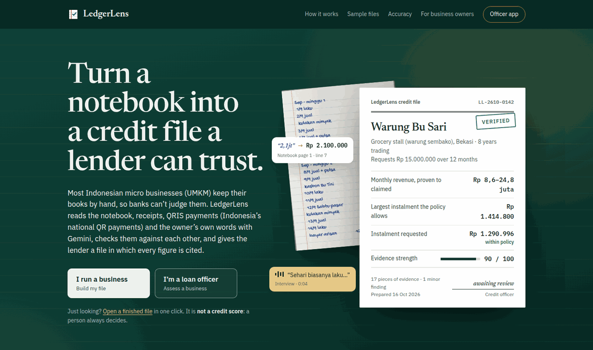
</p>

### Try it in two minutes

There are three ways in. The first needs no waiting at all; the other two run the real analysis with Gemini.

1. **Open a finished credit file.** Open the [Warung Makan Hendra sample](https://ledger-lens-511708.web.app/samples/pak-hendra),
   a food stall whose notebook claims far more than its purchases can support. Click any citation, such as
   *Notebook page 1, line 2*, to see the photographed page beside what Gemini read from it, with that line
   highlighted, or *Interview, 0:04* to hear the owner put his daily sales at a third of what his notebook
   claims. The other two samples are [Warung Bu Sari](https://ledger-lens-511708.web.app/samples/bu-sari)
   (verified) and [Penjahit Pak Joko](https://ledger-lens-511708.web.app/samples/pak-joko) (partially
   verified). These files were analysed in advance, so they open instantly.
2. **Be the business owner** (on a phone if you have one; about five minutes, most of it waiting on the free
   tier): go to [/owner](https://ledger-lens-511708.web.app/owner) and pick a business under **Try with a
   sample business**. Press **Continue**, read who will see your file and agree with **I agree, let's start**,
   then press **Add these sample records** and **Check my records**. When the check is done, read the summary
   written for you, answer a question if you like, and press **Create my share link**. You get a link and an
   8-character code to give a lender.
3. **Be the loan officer.** Open the owner's share link in another browser or a private window, as a lender
   would on their own device (or type the code on the [Applications](https://ledger-lens-511708.web.app/app)
   page). The full credit file joins your list, marked *Shared by owner*. To try the officer-led flow
   instead, go to [/app/new](https://ledger-lens-511708.web.app/app/new), choose **Start from a sample
   business**, then **Create and continue to consent** and **Record consent and continue**. On the evidence
   page, press **Add these records**, then **Run the analysis** and watch the agents work. When the file is
   ready, type an answer under a question for the owner, press **Re-check with the owner's answers**, and
   finish by recording a decision with a written reason.

The demo runs on Gemini's free tier, so it has daily limits for the judging period: 35 analyses or re-checks
a day across the site and 6 per visitor. Beyond that, the four sample files always open.

---

## Contents

- [The problem](#the-problem)
- [What LedgerLens does](#what-ledgerlens-does)
- [What it is not](#what-it-is-not)
- [Screens](#screens)
- [How it works](#how-it-works)
- [How we use Gemini, Firebase, Firestore and Cloud Run](#how-we-use-gemini-firebase-firestore-and-cloud-run)
- [Tech stack](#tech-stack)
- [Responsible AI and data](#responsible-ai-and-data)
- [How we measure it](#how-we-measure-it)
- [Roadmap](#roadmap)
- [Repository layout](#repository-layout)
- [Getting started](#getting-started)
- [Contributing](#contributing)
- [Sources](#sources)
- [Acknowledgements](#acknowledgements)

---

## The problem

Indonesia has around **59.5 million** micro, small and medium businesses (UMKM, *usaha mikro, kecil dan
menengah*), and almost all of them are micro: neighbourhood shops (*warung*), tailors, food stalls and home
bakeries. Only about **one in five** gets credit from a bank.

Usually that isn't because the business is bad. It's because the proof lives in places a bank can't read: a
handwritten notebook, QRIS payments (Indonesia's national QR code payment system) on the owner's phone,
receipts in a drawer and orders in WhatsApp. Banks ask for collateral and formal statements instead, so many
owners are turned away or borrow from moneylenders and illegal lending apps that cost far more.

Large banks have built their own field-officer apps and AI to assess these businesses. Indonesia's
**1,468 rural banks** (BPR, *bank perekonomian rakyat*, and their sharia counterparts, BPRS), along with
cooperatives and microfinance lenders, can't build tools like that. Those small lenders are who LedgerLens
is for.

The timing is right. For government-backed KUR loans (*kredit usaha rakyat*, people's business credit) up to
Rp 100 million, lenders may not demand extra collateral, so they have to judge the business itself.
Indonesia's financial services authority, OJK, now requires lenders to make small-business financing easier
(POJK 19/2025), and its 2025 AI guideline for banks asks for accountability and human oversight.

## What LedgerLens does

LedgerLens has two sides that meet in one credit file. **Business owners** use a phone-first app, in English
with a one-tap switch to Bahasa Indonesia, to photograph their own records, check them and see what they
prove before they ever talk to a lender. **Lenders' loan officers** receive that file through a share link
the owner chooses to send, or build a file themselves on a visit. Either way, the same Gemini pipeline does
the work:

1. **Capture.** With the owner's consent, either the owner sends records from their phone camera or a loan
   officer captures them on a visit: QRIS or e-wallet history, supplier receipts, notebook pages, a short
   voice note or interview recording and photos of the shop. Each item remembers who captured it. On the
   officer's side, an evidence-strength meter shows how much the file can prove before anything is analysed.
2. **Read.** Gemini agents read every item in parallel: messy handwriting and local shorthand (such as
   *"1,2jt"* for Rp 1.2 million), QRIS screenshots, receipts, shop photos and spoken Bahasa. Each notebook
   page is read twice and the two readings are compared.
3. **Calculate.** Plain Python, not the model, turns what was read into rupiah, adds up monthly cash flow and
   runs arithmetic checks, such as "the QRIS rows can't add up to more than the printed total".
4. **Cross-check.** A verifier compares the sources against each other. If the notebook claims several times
   what QRIS and supplier receipts support, that becomes a finding, with citations to the exact lines.
5. **Ask.** Where an owner could explain a gap, LedgerLens writes a polite question in Bahasa. The owner can
   answer it on their phone, or the officer types the answer on a visit, and the file is checked again, just
   as a good credit officer would do it.
6. **Cite and decide.** The file ends in a credit memo in the 5C format lenders already use (Character,
   Capacity, Capital, Collateral, Conditions) and a summary written for the owner in English and Bahasa.
   Every figure links to its evidence, and the officer records the decision with a written reason.

The two sides see different things on purpose. The owner sees their records, a plain summary of what could be
confirmed and what is still missing, three tips to make the file stronger and the questions put to them. The
lender sees the full credit file: the findings, every figure with its source, the outcome and the 5C memo.
The owner never sees the officer's findings, figures or outcome label, so the summary can coach them without
becoming a verdict.

## What it is not

LedgerLens is **not a credit score**. Predicting whether a loan will be repaid needs real repayment history,
and claiming that accuracy without it would be dishonest. Instead, LedgerLens verifies evidence and says how
strong that evidence is. It never rejects anyone automatically. Every file ends in one of four honest outcomes:

| Outcome | Meaning |
| --- | --- |
| **Verified** | The sources agree; a cash-flow range is shown |
| **Partially verified** | Some hard evidence exists; the lower estimate rests on it alone |
| **Insufficient evidence** | Not enough to judge; the lender's normal process applies |
| **Inconsistent** | The sources contradict each other; a person investigates |

When LedgerLens is unsure, the business is no worse off than it is today.

## Screens

All screenshots are of the deployed prototype, with fictional businesses.

**The business owner's side**, on a phone:

<table>
  <tr>
    <td width="33%" valign="top">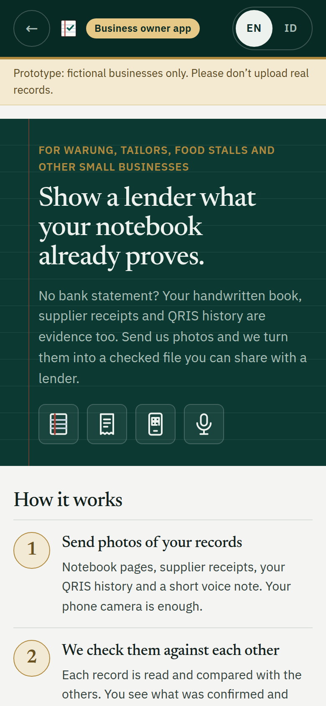<br><sub><b>Start a file.</b> Three steps, no account or password, and sample businesses to try.</sub></td>
    <td width="33%" valign="top">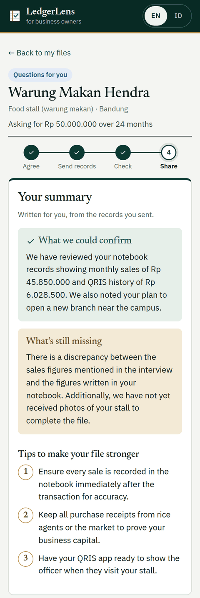<br><sub><b>A summary for the owner.</b> What was confirmed, what is still missing and how to make the file stronger.</sub></td>
    <td width="33%" valign="top">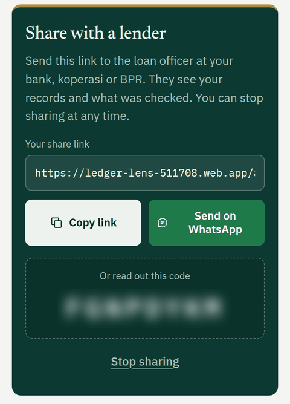<br><sub><b>Share with one lender.</b> A link or a code, also via WhatsApp, and sharing can be stopped at any time.</sub></td>
  </tr>
</table>

**The lender's side**, in the officer app:

<table>
  <tr>
    <td width="50%">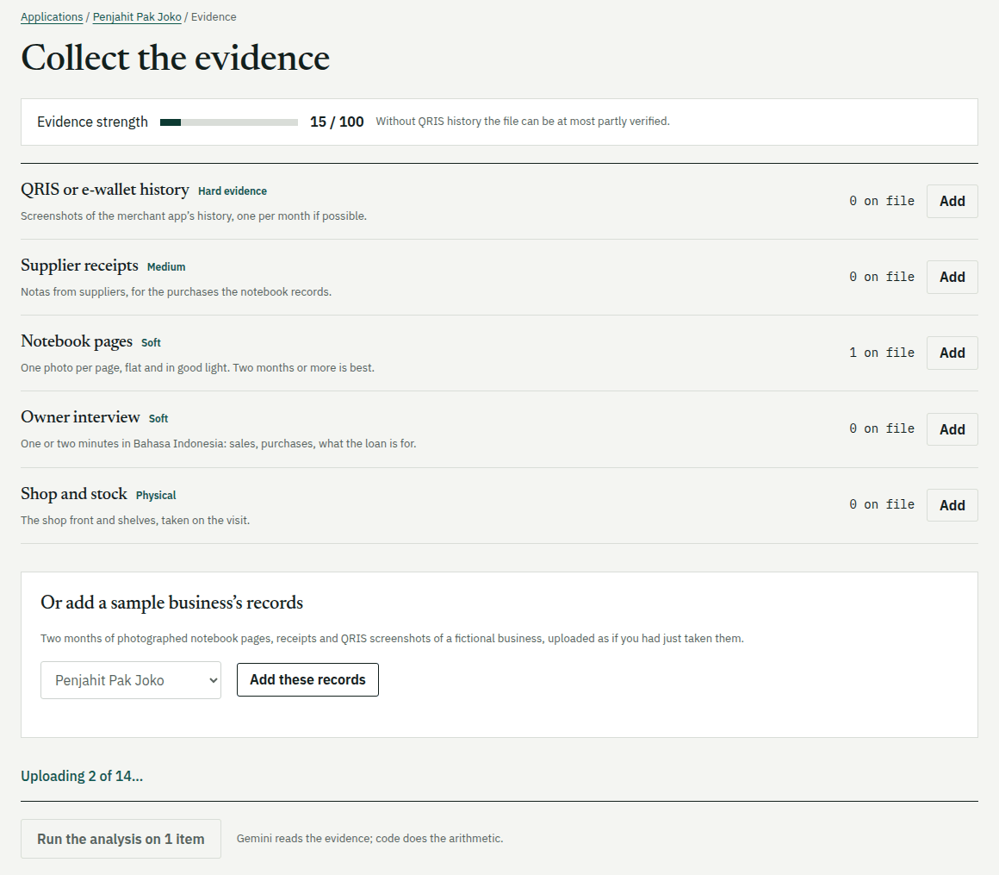<br><sub><b>Collect the evidence.</b> Each kind of evidence is marked hard, medium or soft, and the strength meter explains what the file can prove. A sample business's records can be added in one click.</sub></td>
    <td width="50%">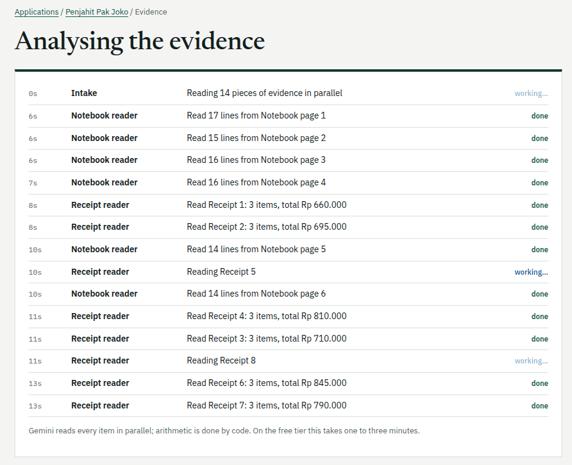<br><sub><b>Watch the analysis.</b> Each reader reports what it read as it finishes, streamed live through Firestore.</sub></td>
  </tr>
  <tr>
    <td><br><sub><b>The credit file.</b> Warung Makan Hendra's notebook claims 5.6 times what its supplier purchases support, so the file is marked Inconsistent and no instalment is suggested.</sub></td>
    <td>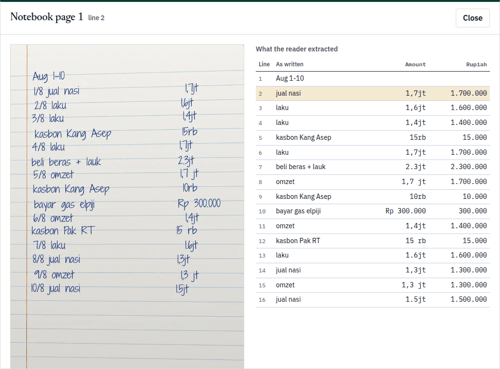<br><sub><b>Every citation opens the evidence.</b> The photographed page sits beside what the reader extracted, with the cited line highlighted.</sub></td>
  </tr>
  <tr>
    <td><br><sub><b>Questions for the owner.</b> The officer reads the question in Bahasa, types the answer and re-checks the file.</sub></td>
    <td>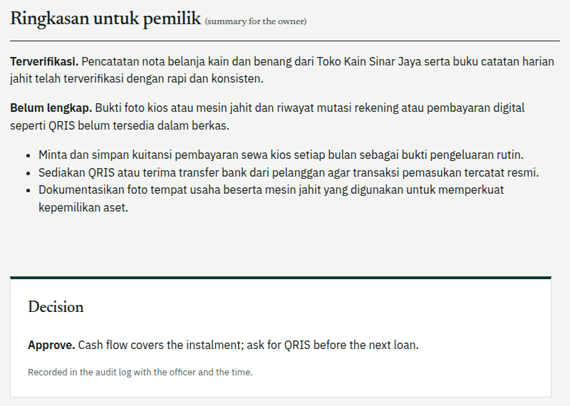<br><sub><b>A person decides.</b> The owner gets a summary in Bahasa; the officer's decision and reason go into the audit log.</sub></td>
  </tr>
</table>

<p align="center">
  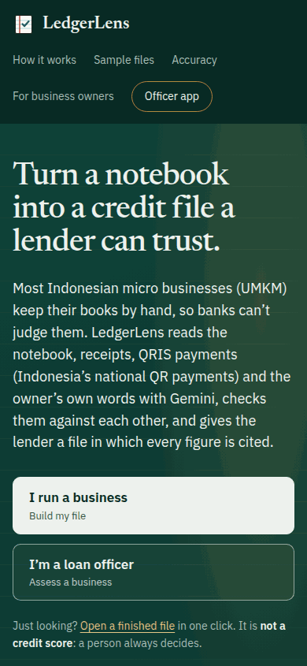<br>
  <sub>Both sides work at phone width: owners use their own phones, and officers work in the field.</sub>
</p>

## How it works

### Architecture

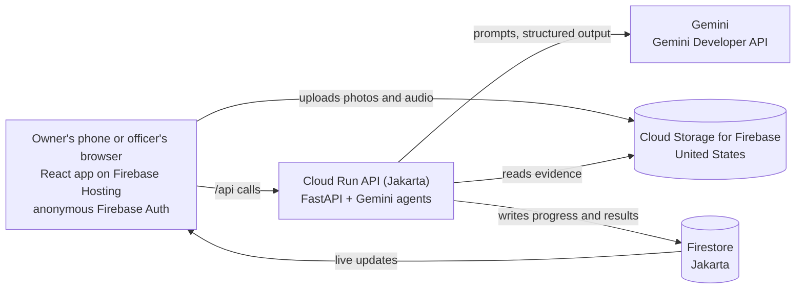

When the owner or the officer starts a check, the whole pipeline runs inside that one Cloud Run request. Each
agent writes its progress to Firestore as it goes, and the app listens to that document, so either side
watches every step finish live. Browsers can only read from Firestore; every write goes through the API.

### Two sides and the handover

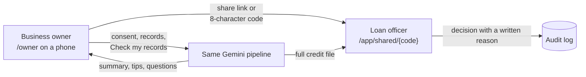

- **The owner holds the file.** An owner starts it at `/owner`, agrees to the consent text, sends records by
  camera and runs **Check my records**. Their files are linked to the browser that started them, and nobody
  else sees them until the owner shares.
- **The handover is a share link.** **Create my share link** gives a link and an 8-character code, which the
  owner can send by WhatsApp or read out. A loan officer opens it at `/app/shared/{code}`, or types the code
  on the Applications page, and the file joins their list marked *Shared by owner*. Every item the owner
  sent is tagged *sent by owner*. The owner's page then shows that a lender has opened it, and the owner can
  stop sharing at any time.
- **One lender at a time.** Once one officer has opened a link, a second officer opening the same link is
  refused.
- **Evidence the owner sends counts for less.** A photo taken by the owner is weaker evidence than one an
  officer captures on a visit, and the verifier is told who captured each item. If the only QRIS history in
  a file was sent by the owner, code adds a finding that asks the officer to confirm it in the merchant app,
  so an owner-only file can be at most *Partially verified* until an officer has done so.
- **Each side reads only its part.** The API and the Firestore security rules enforce it: the owner can read
  their file, their evidence, the progress of a check and the summary written for them, while the lender's
  memo, findings and audit log are for the officer only.
- **No marketplace, on purpose.** LedgerLens has no lender directory and does not match borrowers with
  lenders. In Indonesia, matching a borrower with several lenders or passing a credit file among lenders is
  regulated by OJK, the financial services authority, through its rules for loan aggregators and credit
  information providers (LPIP). So the owner holds the file and chooses one lender at a time, and LedgerLens
  stays a tool that a single lender uses with the owner's permission.

### The agent pipeline

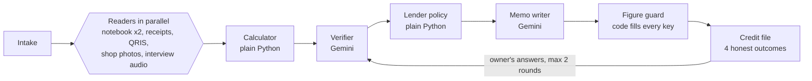

- **Readers** transcribe, they don't interpret. Each returns schema-validated JSON in which every amount
  carries a locator (a page and line, a receipt total or a QRIS row). Each notebook page is read twice;
  where the two readings disagree, that becomes a finding for the officer to check. Owner and officer files
  go through the same readers.
- **The calculator** is plain Python: it parses rupiah shorthand, builds monthly cash flow and runs
  arithmetic checks across the sources.
- **The verifier** (Gemini) cross-checks the sources, cites every finding and writes polite follow-up
  questions in Bahasa. It is told whether the owner or an officer captured each item, and says so when a
  conclusion rests only on what the owner sent.
- **Lender policy** is plain Python: it sets the outcome, applies a haircut to cash flow and computes the
  largest instalment the policy allows.
- **The memo writer** (Gemini) writes the 5C memo for the lender and, separately, the owner's summary:
  what could be confirmed, what is still missing and three tips.
- **The model never produces a number.** The verifier and memo writer may refer to a figure only as a
  `[[key]]` placeholder, such as `[[revenue_low]]`, which code fills in from the calculator's fact table. A
  guard rejects any number the model writes itself: the agent is asked once more, and anything still stray
  is scrubbed.
- **The follow-up loop.** The owner answers on their phone, or the officer types the owner's answers, and
  the file is checked again. Only the
  verifier, policy and memo writer run; the evidence is not read again. An answer can explain a point, but
  code never lets it clear a material contradiction in the figures. The owner can be asked at most twice.
- **The evidence viewer.** Every citation in the credit file opens the evidence photo beside what the reader
  extracted, with the cited line highlighted, and an "Every figure in this file" table lists each figure
  with its source.

## How we use Gemini, Firebase, Firestore and Cloud Run

| Service | What it does in LedgerLens |
| --- | --- |
| **Gemini** | Reads handwriting, QRIS screenshots, receipts, shop photos and Bahasa audio; cross-checks the sources; writes the follow-up questions, the 5C memo and the owner summary, always as schema-validated JSON. The prototype calls the Gemini Developer API (Google AI Studio) on its free tier, with a chain of models per role |
| **Cloud Run** (Jakarta, `asia-southeast2`) | Hosts our FastAPI app and the agent pipeline. An analysis runs inside its request and streams progress through Firestore; request-based billing lets the service scale to zero when idle |
| **Firestore** (Jakarta) | Stores applications, evidence readings, runs (the live trace), the credit file, the owner's summary, share links and the audit log, and streams live progress to both sides |
| **Firebase** | Hosting serves the web app and forwards `/api` to Cloud Run; anonymous Auth means judges, owners and officers meet no login wall; Cloud Storage holds the evidence; security rules let browsers only read, let each user upload only into their own folder, and keep the lender's findings, memo and audit log away from the owner |

## Tech stack

| Layer | What we use | Why |
| --- | --- | --- |
| Web app | React 19, Vite, TypeScript, plain CSS | Phone-first screens for the business owner (English with a Bahasa Indonesia switch) and mobile-first screens for the officer, plus a public landing page and sample files |
| Firebase SDK | `firebase` 12.19.0 | Hosting, anonymous Auth, Storage uploads, Firestore listeners |
| Backend | Python 3.12, FastAPI on Cloud Run | Our API and the agent pipeline |
| AI agents | Google Gen AI SDK 2.30.1, structured output with Pydantic schemas | Five readers that run in parallel; a verifier and a memo writer that may cite figures only by `[[key]]` |
| AI models | Readers: `gemini-3.5-flash-lite`, then `gemini-3.1-flash-lite`. Verifier and memo writer: `gemini-3.8-flash`, falling back through 3.7, 3.6 and 3 Flash, with low thinking | Each model on the free tier has its own quota, so calls are paced per model and a busy model hands over to the next. Vertex AI is supported for production |
| Calculations | Plain Python with unit tests | Every number in the memo |
| Database | Firestore (Native mode, Jakarta) | Application data, audit log, live progress |
| Security | A service account for Google Cloud; the Gemini API key held only in Cloud Run's settings; Firestore and Storage rules | No secrets in this repository; only the backend writes results |
| Deploy and CI | `gcloud run deploy`, Firebase CLI, GitHub Actions for lint, tests and build | Repeatable deploys and checks on every pull request |
| Quality | Our evaluation scripts on synthetic files and a public receipt dataset | Measured accuracy, not claims |

We call the Gemini API directly with the Google Gen AI SDK rather than through an agent framework, which
keeps each agent a small, testable function with one prompt and one output schema.

## Responsible AI and data

- **Consent first.** The owner agrees before any record is captured: on their own phone when they start the
  file themselves (in English or Bahasa Indonesia), or on the officer's screen in both languages during a
  visit. The consent and its time are stored. The text says who will see the file, where the data is kept,
  that Gemini reads it, that a person at the lender decides, and that the owner may withdraw at any time.
- **The owner controls sharing.** A file the owner starts is seen by nobody else until they create a share
  link, and then by one lender only. The owner can stop sharing at any time from their phone.
- **Each side sees only its part.** The API and the Firestore security rules enforce access: the owner reads
  their own file, evidence, progress and summary, while the lender's findings, memo and audit log are for the
  officer only.
- **No personal identifiers.** We store a business alias, never an owner's legal name or national ID number.
- **Where data lives.** Records are stored in Google Cloud's Jakarta region and photos and voice notes in the
  United States.
  AI reading runs on Google's global endpoint. The consent screen says all of this plainly.
- **Prototype versus production.** To keep the hackathon prototype free to run, it calls Gemini through the
  Gemini Developer API's free tier, where Google may use inputs to improve its products. It therefore
  processes only synthetic data. A lender deployment would call Gemini through Vertex AI, where inputs are not
  used that way; the code supports both.
- **Human oversight.** No automatic rejections. Every decision (approve, ask for more evidence, or decline)
  needs a person and a written reason, recorded in an audit log, in line with OJK's AI governance principles.
- **Synthetic data only.** Every business, notebook and receipt in this repository is fictional and made by
  our team. The one outside dataset we test with, CORD, holds public shop receipts and is downloaded at test
  time, never committed (see [Acknowledgements](#acknowledgements)).

## How we measure it

**Measured so far** (October 2026):

| Test | Data | Result |
| --- | --- | --- |
| Receipt reader | First 30 receipts of the CORD test split: real photos from Indonesian shops and restaurants | Total paid read exactly on 28 of 29 labelled receipts (97%); 69 of 69 item amounts found |
| Notebook reader | 9 synthetic pages from 3 fictional businesses in 8 handwriting fonts, photographed with tilt, blur and uneven light | 162 of 162 amounts read exactly with the better prompt variant (the other read 160; both misses were crossed-out corrections, since fixed) |
| Whole pipeline | 4 sample credit files, two months each: 6 notebook pages, 8 receipts and, where the business has them, 2 QRIS screenshots and a 30-second owner interview in Bahasa Indonesia | Every monthly notebook, QRIS and receipt total read exactly, and each file got the outcome its evidence supports (below) |
| Real handwriting | Pages written and photographed by our team | In progress |

The four sample files:

| Business | Outcome | Why |
| --- | --- | --- |
| Warung Bu Sari, a grocery stall in Bekasi | **Verified** | Evidence strength 90/100; the requested instalment of Rp 1.290.996 is within the policy maximum of Rp 1.414.800 |
| Penjahit Pak Joko, a tailor in Yogyakarta | **Partially verified** | No QRIS history, so the low end rests on receipts alone; evidence strength 55/100 |
| Warung Makan Hendra, a food stall in Bandung | **Inconsistent** | The notebook claims 5.6 times what supplier purchases support, QRIS shows 13% of claimed sales, and in the interview the owner himself puts daily sales at Rp 500.000, a third of what the notebook says; no instalment is suggested |
| Toko Baju Bu Wati, a clothing reseller in Surabaya | **Inconsistent** | Its September QRIS screenshot was edited: all 22 payments are listed and add up to Rp 4.400.000, but the printed total says Rp 9.400.000. Only the listed payments count as money received, so the low end of cash flow stays at what was really paid; no instalment is suggested |

On the free tier a full analysis of 14 to 16 items takes 30 to 220 seconds, depending on Gemini's load, and a
re-check with the owner's answers needs only about 7 seconds of verifier time. The prototype runs on Gemini's
free tier and within the free allowances of Cloud Run, Firestore and Hosting.

We also ran the owner's side end to end on the live site, on a 390-pixel-wide phone screen: the Warung Makan
Hendra sample with 17 records was checked in about 106 seconds and gave a summary with 4 questions, and a
separate lender browser opened the share link and saw the full file, marked Inconsistent.

To reproduce these results (see [`eval/README.md`](eval/README.md) and [`api/README.md`](api/README.md)):

| Script | What it does |
| --- | --- |
| `eval/synth_notebooks.py` | Writes synthetic notebook pages with their true amounts |
| `eval/synth_evidence.py` | Writes a complete two-month sample file: notebook pages, receipts and QRIS screenshots |
| `eval/synth_interview.py` | Records a short owner interview in Bahasa Indonesia with Gemini's text-to-speech |
| `api/scripts/handwriting_test.py` | Reads notebook pages with both prompt variants and scores them against the truth |
| `api/scripts/receipt_eval.py` | Scores the receipt reader on CORD (`cd api && python -m scripts.receipt_eval --count 30`) |
| `api/scripts/run_sample.py` | Runs the whole analysis on a sample file and prints each figure next to the truth |

The one receipt miss was a receipt that prints a single summary amount, which the reader filed as the
subtotal rather than the total. The synthetic pages are fonts, not real handwriting: they test layout,
shorthand and photo quality, and results on the team's own handwritten pages will be added when they are in.

## Roadmap

**Hackathon build (October 2026)**

- [x] Walking skeleton: web app, API and a first Gemini reading, deployed
- [x] End-to-end assessment on the live URL: capture, analysis with a live trace, credit file, follow-up
  questions, decision
- [x] Evidence viewer, published sample files and measured accuracy on synthetic and public data
- [x] The business owner's side: an owner-held file built on a phone, with the owner's own consent, a
  summary and questions written for them, and a check of what they send
- [x] Sharing with one lender by link or code, which the owner can stop at any time, with evidence the owner
  sent marked as weaker and access enforced by Firestore rules
- [ ] Real handwriting test on the team's own pages
- [ ] Submission: deck, demo video and the live prototype kept up for judging

**After the hackathon**

1. **Shadow pilot** with one or two rural banks for 3–6 months, running alongside their officers without
   affecting decisions.
2. **Assisted decisions** for small loans once the pilot proves itself.
3. **A credit-committee view** for lenders, and letting an owner move their file from one lender to the next.
4. **An API** for licensed online lenders and financing companies.
5. **Reaching more than one lender** only through a licensed partner, such as a loan aggregator, if OJK's
   rules allow it. We will not run an unlicensed marketplace.
6. **A transparent risk model**, trained only on real repayment outcomes collected with consent and tested
   for fairness, working with a licensed alternative-credit-rating partner where regulation requires it.

## Repository layout

```
web/                React + Vite + TypeScript app (landing page, sample files, owner app, officer app)
  src/pages/owner/    the business owner's side: home, new file, consent, records, summary and sharing
  src/pages/officer/  new application, consent, evidence, analysis, shared files and the credit file
  public/samples/     the published sample files and their evidence photos
api/                Python 3.12 FastAPI app and the agent pipeline
  app/agents/         one module per agent: its prompt and output schema
  app/analysis/       the pipeline that runs the agents and the code between them
  app/tools/          rupiah parsing, cash flow, policy and the fact table, in plain Python
  app/routers/        HTTP routes under /api
  scripts/            evaluation and sample runners
  tests/              offline tests (Gemini, Firestore and Auth are faked)
eval/               synthetic data generators and evaluation notes
data/synthetic/     synthetic notebook pages with their true amounts
data/samples/       three complete fictional sample files with their true figures
assets/screens/     screenshots used in this README
.github/workflows/  CI for the API and the web app
firebase.json       Hosting (with the /api rewrite to Cloud Run), Firestore and Storage settings
```

## Getting started

You need Python 3.12, Node.js, the Google Cloud CLI and the Firebase CLI, plus a Google Cloud project with
Firestore, Cloud Storage for Firebase and anonymous Auth turned on.

1. Copy `.env.example` to `.env` and fill in your project. Set `GEMINI_API_KEY` to a Google AI Studio key to
   use the Gemini Developer API, or leave it empty to use Vertex AI through your Google credentials. Never
   commit it.
2. Sign in for Firestore and Storage with `gcloud auth application-default login`.
3. Run the API:

   ```bash
   cd api
   python3.12 -m venv .venv && .venv/bin/pip install -r requirements-dev.txt
   .venv/bin/uvicorn app.main:app --reload --port 8080
   ```

4. Run the web app. Copy `.env.example` to `web/.env.development.local` and fill in the `VITE_FIREBASE_*`
   values from your Firebase web app's config (they are not secret, but they belong to your project):

   ```bash
   cd web
   npm install
   npm run dev      # http://localhost:5173; Vite forwards /api to port 8080
   ```

5. Run the tests with `cd api && .venv/bin/pytest -q`, and build the web app with `cd web && npm run build`.

Deploying is covered in [`api/README.md`](api/README.md) (Cloud Run) and [`web/README.md`](web/README.md)
(Firebase Hosting and rules).

## Contributing

See [CONTRIBUTING.md](CONTRIBUTING.md) for our branch, pull-request and commit-message conventions.

## Sources

- Number of UMKM and bank-credit access: [UGM, Ministry of Cooperatives and SMEs](https://ugm.ac.id/en/news/minister-teten-masduki-aims-for-unsecured-credit-rules-for-msmes-to-be-completed-this-year/)
- POJK 19/2025 on easier MSME financing: [Kontan](https://keuangan.kontan.co.id/news/ojk-resmi-terbitkan-aturan-untuk-pembiayaan-umkm-ini-rinciannya)
- OJK AI governance guideline for banks: [OJK](https://ojk.go.id/id/Publikasi/Roadmap-dan-Pedoman/Perbankan/Pages/Tata-Kelola-Kecerdasan-Artifisial-Perbankan-Indonesia.aspx)
- Number of rural banks (BPR/BPRS): [Kontan](https://keuangan.kontan.co.id/news/ojk-percepat-konsolidasi-sejumlah-bpr-berguguran-sepanjang-2025)
- No extra collateral for KUR loans up to Rp 100 million: [Kontan](https://nasional.kontan.co.id/news/kementerian-umkm-tegaskan-kur-hingga-rp-100-juta-tak-perlu-agunan-tambahan)

## Acknowledgements

The receipt reader is evaluated on **CORD** (Consolidated Receipt Dataset), by Seunghyun Park, Seung Shin,
Bado Lee, Junyeop Lee, Jaeheung Surh, Minjoon Seo and Hwalsuk Lee, *CORD: A Consolidated Receipt Dataset for
Post-OCR Parsing*, Document Intelligence Workshop at NeurIPS 2019. It is published by NAVER Clova under the
[CC BY 4.0](https://creativecommons.org/licenses/by/4.0/) licence at
[huggingface.co/datasets/naver-clova-ix/cord-v2](https://huggingface.co/datasets/naver-clova-ix/cord-v2). We
download it at test time and do not redistribute or modify it.
