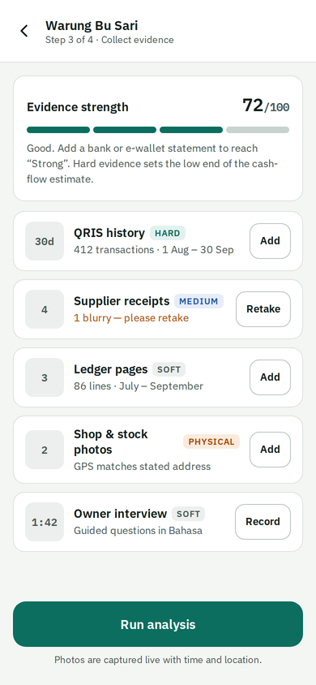
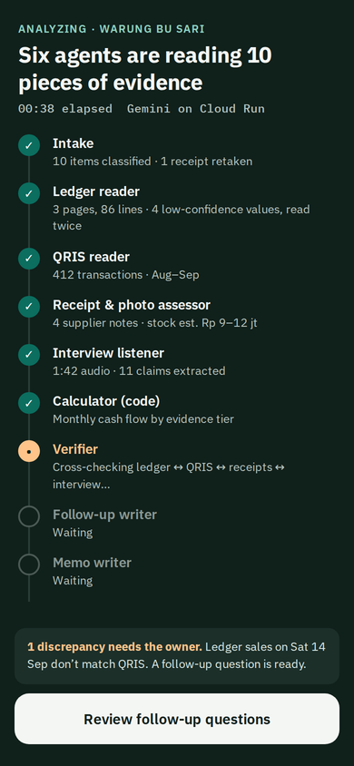
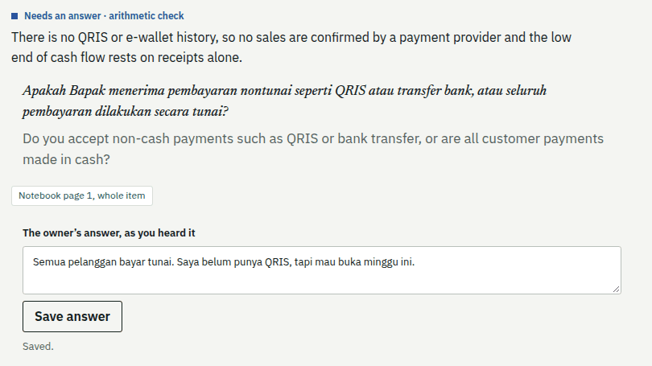
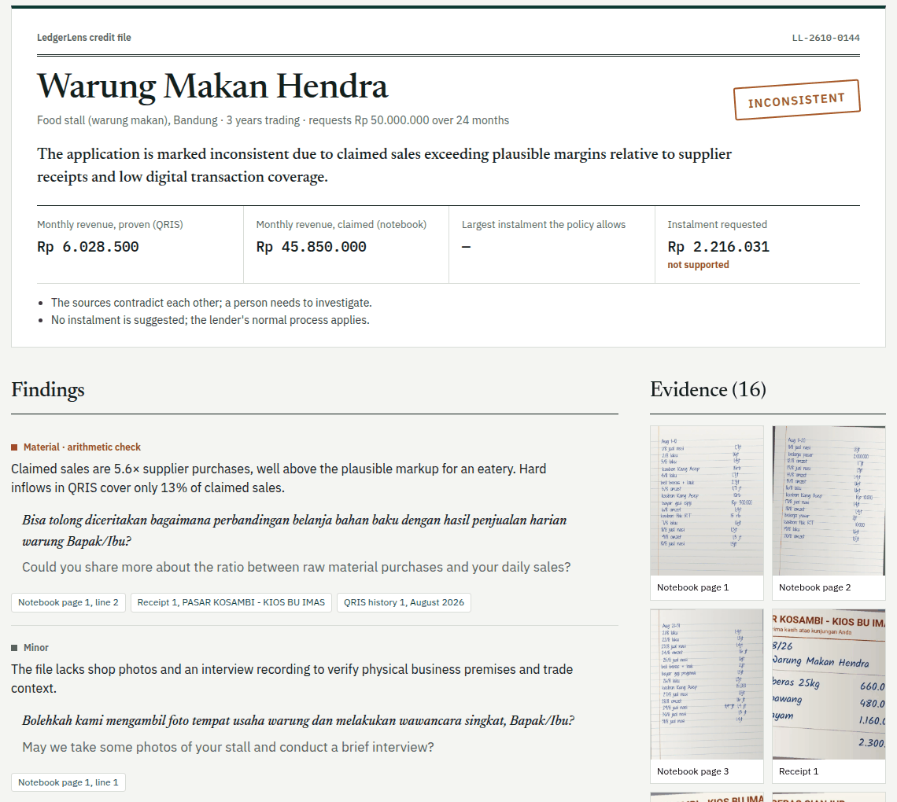
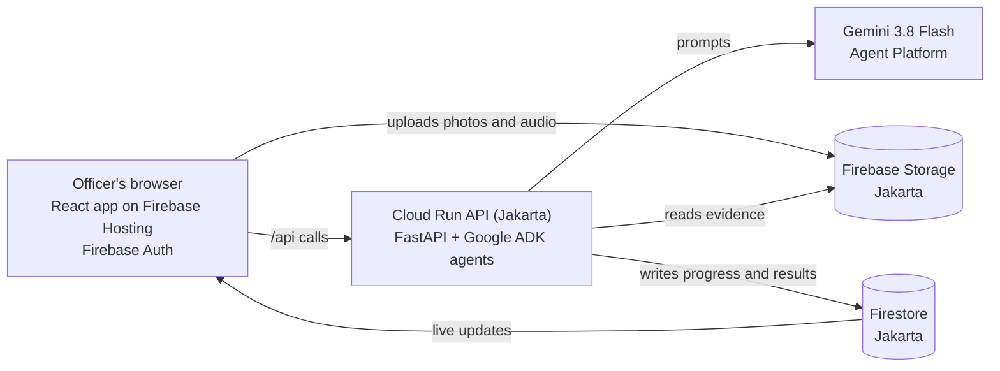
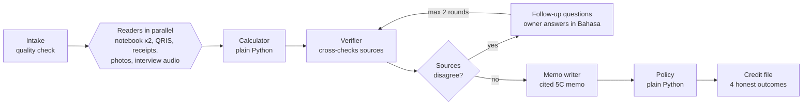

# LedgerLens

**An AI credit analyst for Indonesia's informal micro businesses.**

LedgerLens turns the evidence a small business already has (handwritten notebook pages, QRIS payment
history, supplier receipts, photos of the shop and a short interview with the owner) into a verified credit
file that a loan officer can trust. Every number in the file links back to the photo or recording it came
from, and a human always makes the lending decision.

> **Status:** in active development for the Google Cloud AI Builder Cup 2026, organised by Hack2skill
> (theme: BFSI, Intelligent Risk, Fraud & Financial Experiences). This README describes the plan we are building against; sections marked
> *planned* will be replaced with working instructions and measured results as the code lands.

---

## Contents

- [The problem](#the-problem)
- [What LedgerLens does](#what-ledgerlens-does)
- [What it is not](#what-it-is-not)
- [Features](#features)
- [How it works](#how-it-works)
- [How we use Gemini, Firebase, Firestore and Cloud Run](#how-we-use-gemini-firebase-firestore-and-cloud-run)
- [Tech stack](#tech-stack)
- [Responsible AI and data](#responsible-ai-and-data)
- [How we measure it](#how-we-measure-it)
- [Roadmap](#roadmap)
- [Repository layout](#repository-layout)
- [Getting started](#getting-started)
- [Contributing](#contributing)
- [Sources](#sources)
- [Acknowledgements](#acknowledgements)

---

## The problem

Indonesia has around **59.5 million** micro, small and medium businesses (UMKM), and almost all of them are
micro: neighbourhood shops (*warung*), tailors, food stalls and home bakeries. Only about **one in five** gets
credit from a bank.

Usually that isn't because the business is bad. It's because the proof lives in places a bank can't read: a
handwritten notebook, QRIS payments (Indonesia's national QR code payment system) on the owner's phone,
receipts in a drawer and orders in WhatsApp. Banks ask for collateral and formal statements instead, so many
owners are turned away or borrow from moneylenders and illegal lending apps that cost far more.

Large banks have built their own field-officer apps and AI to assess these businesses. Indonesia's
**1,468 rural banks** (BPR and their sharia counterparts, BPRS), along with cooperatives and microfinance
lenders, can't build tools like that. Those small lenders are who LedgerLens is for.

The timing is right. For government-backed KUR loans up to Rp 100 million, lenders may not demand extra
collateral, so they have to judge the business itself. Indonesia's financial regulator, OJK, now requires
lenders to make small-business assessment easier (POJK 19/2025), and its 2025 AI guideline for banks asks
for accountability and human oversight.

## What LedgerLens does

1. **Capture.** With the owner's consent, a loan officer photographs whatever records the business has and
   records a 1–2 minute interview in Bahasa Indonesia. Photos are captured live, with time and location.
2. **Read.** Gemini agents read every item in parallel: messy handwriting and local shorthand (such as
   *"1,2jt"* for Rp 1.2 million), QRIS screenshots, receipts, shop photos and spoken Bahasa.
3. **Cross-check.** A verifier compares the sources against each other. If the notebook claims three times
   what QRIS and supplier receipts support, that is flagged, with citations.
4. **Ask.** When sources disagree, LedgerLens writes a polite follow-up question for the owner in Bahasa,
   then checks again with the answer, just as a good credit officer would.
5. **Cite.** It produces a credit memo in the 5C format lenders already use (Character, Capacity, Capital,
   Collateral, Condition). Every figure links to its evidence, and plain Python code, not the AI, computes
   every number.

<p align="center">
  
  
  
  
</p>
<p align="center"><em>Design mockups with synthetic data. Screenshots of the deployed prototype will replace them.</em></p>

## What it is not

LedgerLens is **not a credit score**. Predicting whether a loan will be repaid needs real repayment history,
and claiming that accuracy without it would be dishonest. Instead, LedgerLens verifies evidence and says how
strong that evidence is. It never rejects anyone automatically. Every file ends in one of four honest outcomes:

| Outcome | Meaning |
| --- | --- |
| **Verified** | The sources agree; a cash-flow range is shown |
| **Partially verified** | Some hard evidence exists; the lower estimate rests on it alone |
| **Insufficient evidence** | Not enough to judge; the lender's normal process applies |
| **Inconsistent** | The sources contradict each other; a person investigates |

When LedgerLens is unsure, the business is no worse off than it is today.

## Features

- **Captures any evidence**: notebook pages, QRIS and e-wallet history, receipts, WhatsApp orders, shop and
  stock photos, and a voice interview.
- **An evidence-strength meter**: hard evidence (QRIS, e-wallet or bank history) sets the lower bound of the
  cash-flow estimate; soft evidence (notebooks, interview claims) can never raise it on its own.
- **Cross-source verification** that catches inflated notebooks and edited screenshots.
- **Follow-up questions** for the owner in Bahasa Indonesia, with re-verification.
- **A cited 5C credit memo** with an evidence viewer: tap a number to see the exact line on the photographed page.
- **A credit-committee console** where every decision requires a written reason and goes into an audit log.
- **An owner summary in Bahasa**: what was verified, how to strengthen the file, and controls to share it
  with another lender or withdraw consent. The file belongs to the business.

## How it works

### Architecture



When the officer taps **Run analysis**, the API replies immediately with a run ID and keeps working in the
background. Each agent writes its progress to Firestore, and the app listens to that document, so the
officer watches every step finish live without waiting on one long request.

### The agent pipeline



Rules every agent follows:

- **Structured output only.** Each agent returns JSON validated against a schema.
- **Every value carries a confidence and a locator** (page and line, or a time in the audio).
- **The notebook is read twice** with different prompts; disagreements are flagged for the officer to confirm.
- **The AI never does arithmetic.** Totals, cash flow and the maximum instalment come from tested Python code.
- **A human always decides.** LedgerLens recommends; the lender's credit officer approves or declines.

## How we use Gemini, Firebase, Firestore and Cloud Run

| Service | What it does in LedgerLens |
| --- | --- |
| **Gemini** (3.8 Flash on Google's Agent Platform) | Reads handwriting, QRIS screenshots, receipts, photos and Bahasa audio; cross-checks the sources; writes follow-up questions, the 5C memo and the owner summary, always as schema-validated JSON |
| **Cloud Run** (Jakarta) | Hosts our Python API and the agent workflow built with Google's Agent Development Kit (ADK), running each analysis as a background job with one instance always on |
| **Firestore** (Jakarta) | Stores applications, evidence metadata, findings, memos and the audit log, and streams live analysis progress to the app |
| **Firebase** | Hosting serves the web app and forwards `/api` to Cloud Run; Auth signs judges in anonymously so there is no login wall; Storage holds the photos and audio |

## Tech stack

| Layer | What we use | Why |
| --- | --- | --- |
| Web app | React, Vite, TypeScript, plain CSS | Mobile-first screens for officers, the committee and owners |
| Firebase SDK | `firebase` 12.19.0 | Hosting, anonymous Auth, Storage uploads, Firestore listeners |
| Backend | Python 3.12, FastAPI on Cloud Run | Our API; background analysis jobs |
| AI agents | Google ADK 2.12.0, Google Gen AI SDK 2.30.1 | Agent definitions, parallel readers, the follow-up loop |
| AI models | `gemini-3.8-flash` (main), `gemini-3.5-flash` (fallback) | Multimodal reading and reasoning in Bahasa and English |
| Calculations | Plain Python with unit tests | Every number in the memo |
| Database | Firestore (Native mode, Jakarta) | Application data, audit log, live progress |
| Security | Service account with no API keys; Firestore and Storage rules | No secrets in this repository; only the backend writes results |
| Deploy and ops | `gcloud run deploy`, Firebase CLI, Cloud Logging, budget alerts | Repeatable deploys; visibility into errors and cost |
| Quality | Our evaluation harness on synthetic files | Measured accuracy, not claims |

## Responsible AI and data

- **Consent first.** The owner agrees, on screen, before any record is captured. The consent version and time
  are stored, and the owner can withdraw it at any time.
- **No personal identifiers.** We store a business alias, never an owner's legal name or national ID number.
- **Where data lives.** Records are stored in Google Cloud's Jakarta region and photos in the United States.
  Gemini is not yet served from Jakarta, so AI processing runs on Google's global endpoint. The consent screen
  says all of this plainly.
- **Human oversight.** No automatic rejections; every decision needs a person and a written reason, recorded
  in an audit log, in line with OJK's AI governance principles.
- **Synthetic data only.** Every business, notebook and recording in this repository is fictional and made by
  our team. The one outside dataset we test with, CORD, holds public shop receipts and is downloaded at test
  time, never committed (see [Acknowledgements](#acknowledgements)).

## How we measure it

**Measured so far** (`gemini-3.8-flash`, October 2026):

| Test | Data | Result |
| --- | --- | --- |
| Receipt reader | First 30 receipts of the CORD test split: real photos from Indonesian shops and restaurants | Total paid read exactly on 28 of 29 labelled receipts (97%); 69 of 69 item amounts found |

Run it yourself with `cd api && python -m scripts.receipt_eval --count 30`. The one miss was a receipt that
prints a single summary amount, which the reader filed as the subtotal rather than the total.

**Planned:** we are building seven fictional businesses, each with handwritten notebook pages, QRIS histories, receipts
and recorded interviews, so we know their true numbers. Two of them hide planted problems (an inflated notebook
and an edited QRIS screenshot). Across about 30 test files we will report:

| Metric | What it tells us |
| --- | --- |
| Reading accuracy | How often amounts read from photos match the truth (within 1%) |
| Safe flagging | How many wrong readings were marked low-confidence for a human to check |
| Cash-flow error | How far the monthly estimate is from the real figure |
| Planted problems caught | Whether the inflated notebook and the edited screenshot are flagged |
| Speed and cost | Seconds from "Run analysis" to memo, and AI cost per assessment |

## Roadmap

**Hackathon build (October 2026)**

- [ ] `v0.1.0` Walking skeleton: web app, API and a first Gemini reading, deployed
- [ ] `v0.5.0` End-to-end assessment working on the live URL
- [ ] `v1.0.0` Submission: evaluation results, demo video and live prototype

**After the hackathon**

1. **Shadow pilot** with one or two rural banks for 3–6 months, running alongside their officers without
   affecting decisions.
2. **Assisted decisions** for small loans once the pilot proves itself.
3. **An API** for licensed online lenders and financing companies.
4. **A transparent risk model**, trained only on real repayment outcomes collected with consent and tested
   for fairness, working with a licensed alternative-credit-rating partner where regulation requires it.

## Repository layout

*Planned structure; folders appear as the code lands.*

```
web/              React + Vite + TypeScript app
api/              Python 3.12 FastAPI app and the agent workflow
  app/agents/     one module per agent: its prompt and output schema
  app/tools/      calculator and policy, plain Python with unit tests
eval/             evaluation harness and its latest report
data/synthetic/   fictional businesses and their true values
assets/           images used in this README
```

## Getting started

*Planned; will be finalised with the first code release.*

1. Copy `.env.example` to `.env` and fill in your Google Cloud project and Firebase web config.
2. Sign in for local development with `gcloud auth application-default login`. LedgerLens uses no API keys.
3. Run the API: `cd api && uvicorn app.main:app --reload --port 8080`.
4. Run the web app: `cd web && npm install && npm run dev`. Vite forwards `/api` to port 8080.

## Contributing

See [CONTRIBUTING.md](CONTRIBUTING.md) for our branch, pull-request and commit-message conventions.

## Sources

- Number of UMKM and bank-credit access: [UGM, Ministry of Cooperatives and SMEs](https://ugm.ac.id/en/news/minister-teten-masduki-aims-for-unsecured-credit-rules-for-msmes-to-be-completed-this-year/)
- POJK 19/2025 on easier MSME financing: [Kontan](https://keuangan.kontan.co.id/news/ojk-resmi-terbitkan-aturan-untuk-pembiayaan-umkm-ini-rinciannya)
- OJK AI governance guideline for banks: [OJK](https://ojk.go.id/id/Publikasi/Roadmap-dan-Pedoman/Perbankan/Pages/Tata-Kelola-Kecerdasan-Artifisial-Perbankan-Indonesia.aspx)
- Number of rural banks (BPR/BPRS): [Kontan](https://keuangan.kontan.co.id/news/ojk-percepat-konsolidasi-sejumlah-bpr-berguguran-sepanjang-2025)
- No extra collateral for KUR loans up to Rp 100 million: [Kontan](https://nasional.kontan.co.id/news/kementerian-umkm-tegaskan-kur-hingga-rp-100-juta-tak-perlu-agunan-tambahan)

## Acknowledgements

The receipt reader is evaluated on **CORD** (Consolidated Receipt Dataset), by Seunghyun Park, Seung Shin,
Bado Lee, Junyeop Lee, Jaeheung Surh, Minjoon Seo and Hwalsuk Lee, *CORD: A Consolidated Receipt Dataset for
Post-OCR Parsing*, Document Intelligence Workshop at NeurIPS 2019. It is published by NAVER Clova under the
[CC BY 4.0](https://creativecommons.org/licenses/by/4.0/) licence at
[huggingface.co/datasets/naver-clova-ix/cord-v2](https://huggingface.co/datasets/naver-clova-ix/cord-v2). We
download it at test time and do not redistribute or modify it.
